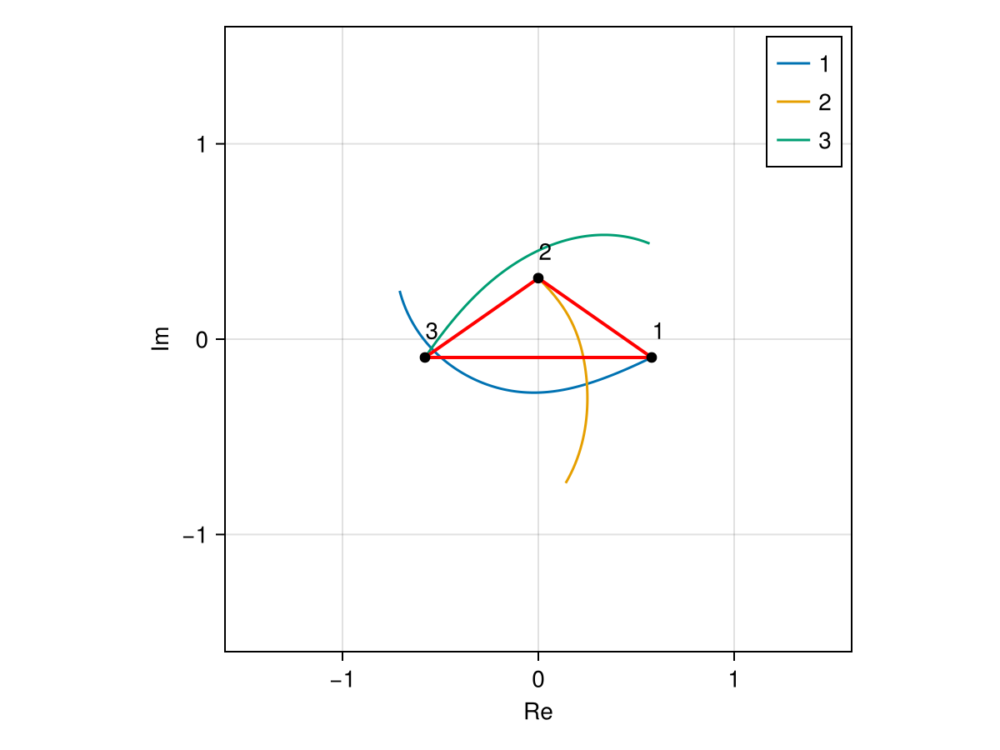

# HomotopyResurgence.jl
[](https://jfeldbrugge.github.io/HomotopyResurgence.jl/stable/)
[](https://jfeldbrugge.github.io/HomotopyResurgence.jl/dev/)
[](https://github.com/jfeldbrugge/HomotopyResurgence.jl/actions/workflows/CI.yml?query=branch%3Amain)
[](https://codecov.io/gh/jfeldbrugge/HomotopyResurgence.jl)

The Stokes constants of multidimensional oscillatory integrals

$$\Psi(k) = \left(\frac{k}{2\pi i}\right)^{d/2} \int_{\mathbb{R}^d} e^{i k f(\boldsymbol{x})} \mathrm{d}\boldsymbol{x}$$

with a polynomial (or, by a polynomial lift, rational) exponent $f$ are evaluated by homotopy continuation, implemented in Julia. The package starts from a factorisable reference integral, whose Stokes constants follow from one-dimensional integrals, and deforms it into the integral of interest. Along the way, it tracks the saddle points and their Borel singularities and updates the Stokes constants at every higher-order Stokes phenomenon, when the Borel singularity of one saddle point crosses the segment between two others. The method requires neither asymptotic series nor steepest-descent manifolds, and it carries Stokes constants of any magnitude. This code accompanies the publication *Stokes Constants through Homotopy* (arXiv link to follow), with animations of the homotopies at [jfeldbrugge.github.io/Stokes-Constants-through-Homotopy](https://jfeldbrugge.github.io/Stokes-Constants-through-Homotopy/).

## Installation

HomotopyResurgence is not yet in the General registry. Install it from GitHub with the Julia package manager. From the Julia REPL, type `]` to enter the Pkg REPL mode and run:

```julia
pkg> add https://github.com/jfeldbrugge/HomotopyResurgence.jl
```

Or, equivalently, via the `Pkg` API:

```julia
julia> using Pkg; Pkg.add(url = "https://github.com/jfeldbrugge/HomotopyResurgence.jl")
```

The plotting function `plotHomotopy` lives in a package extension, which loads together with a Makie backend. To draw the figures, install and load `CairoMakie` (or `GLMakie`); without a backend, the rest of the package installs and loads without Makie.

## Usage
For the Pearcey integral with exponent $f(q) = q^4 + q^2/2 + q$, we compute the saddle points, their Borel singularities and the Stokes constants as follows:

```julia
using HomotopyResurgence, CairoMakie   # CairoMakie for plotHomotopy

f(q) = q[1]^4 + q[1]^2 / 2 + q[1]

# Homotopy from the reference integral with index m = 4 (m - 1 ≥ deg f'), in N steps
r = stokesHomotopy(f, [4]; N = 4000)

r.x    # saddle points:      0.25 + 0.6614im, -0.5, 0.25 - 0.6614im
r.Σ    # Borel singularities t = -i f(x): 0.5788 - 0.0938im, 0.3125im, -0.5788 - 0.0938im
r.K    # Stokes constants K[j, l] = K_jl (Berry & Howls): the series of j sees saddle l
# 3×3 Matrix{Int64}:
#   0   1  1
#  -1   0  1
#  -1  -1  0

# The tracks of the Borel singularities and the adjacency graph at the end of the homotopy
fig, ax = plotHomotopy(r.pathsBorel, r.K, 1.6)
```

The figure shows the Borel singularities of the three saddle points as they move from the reference integral to the Pearcey integral. Every pair of saddle points ends up adjacent (red edges).

<p align="center">
<a href='docs/src/assets/figures/homotopy.png'></a>
</p>

For a rational exponent, lift it to a polynomial in more variables. For the mirror of $\mathbb{CP}^2$, $f = x + y + 1/(xy)$, an auxiliary variable $w$ replaces $1/(xy)$ and a multiplier $s$ enforces $wxy = 1$:

```julia
P(q) = q[1] + q[2] + q[3] + q[4] * (q[3] * q[1] * q[2] - 1)   # q = (x, y, w, s)
r = stokesHomotopy(P, [4, 4, 4, 4]; N = 4000)

length(r.pathsBorel)   # 81 saddle points of the reference integral
r.Σ                    # the 3 that reach P: Borel singularities 2.5981 + 1.5im, -2.5981 + 1.5im, -3.0im
r.K                    # Stokes constants of magnitude 3, built through higher-order Stokes phenomena
# 3×3 Matrix{Int64}:
#   0  3  -3
#  -3  0  -3
#   3  3   0
```

The saddle points that fly off to infinity leave the analysis, and the Stokes constants are given for the normalisation of the series fixed by `seriesNormalisation` (stationary phase for real saddle points, the principal branch for complex ones).

Please have a look at the docstrings (e.g. `?stokesHomotopy`) for more details. The documentation is under development.

## Contributors
This code was written by:
* Job Feldbrugge ([jobfeldbrugge@ntu.edu.tw](mailto:jobfeldbrugge@ntu.edu.tw))

## Citations
When using this code in work, please cite

```
@article{AnicetoFeldbruggeHowls2026,
    author = {Aniceto, In{\^e}s and Feldbrugge, Job and Howls, Christopher J.},
    title = {Stokes Constants through Homotopy},
    year = {2026},
    note = {arXiv identifier to follow},
}

@misc{Feldbrugge2026Homotopy,
  author = {Feldbrugge, Job},
  title = {HomotopyResurgence.jl -- Julia implementation of the homotopy continuation of Stokes constants},
  year = {2026},
  url = {https://github.com/jfeldbrugge/HomotopyResurgence.jl}
}
```
